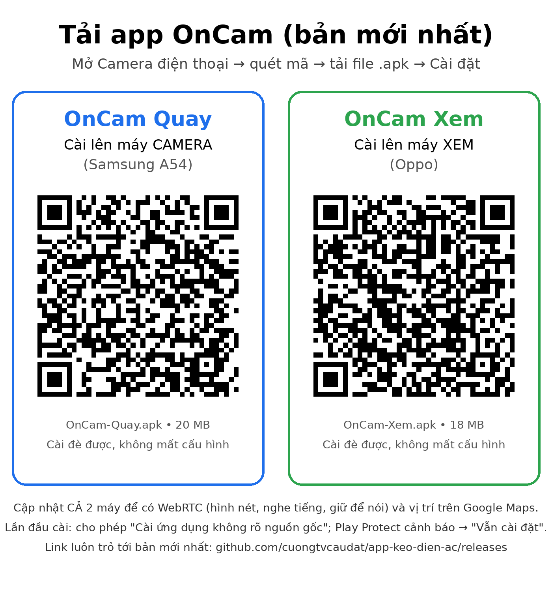

# OnCam — Camera giám sát theo yêu cầu (On-Demand Android Security Camera)

Biến điện thoại Android cũ thành camera đặt ở sân nhà. Máy cũ **luôn nghe lệnh** nhưng **chỉ mở camera khi được gọi** từ điện thoại xem, xem xong tự tắt để giảm nóng, hao pin và băng thông.

| App | Cài trên | Package |
|---|---|---|
| `camera-node` — **OnCam Quay** | Điện thoại cũ đặt ở sân | `vn.cnldg.oncam.node` |
| `viewer` — **OnCam Xem** | Điện thoại chính | `vn.cnldg.oncam.viewer` |
| `shared` | (thư viện dùng chung) | `vn.cnldg.oncam.shared` |

## Tải app (bản mới nhất)

| App | Cài lên | Link tải thẳng file .apk |
|---|---|---|
| **OnCam Quay** | Máy làm camera | https://github.com/cuongtvcaudat/app-keo-dien-ac/releases/download/oncam-latest/OnCam-Quay.apk |
| **OnCam Xem** | Máy dùng để xem | https://github.com/cuongtvcaudat/app-keo-dien-ac/releases/download/oncam-latest/OnCam-Xem.apk |

Quét bằng camera điện thoại:



Hướng dẫn từ A–Z: [docs/USER_GUIDE.md](docs/USER_GUIDE.md) · Tailscale: [docs/SETUP_TAILSCALE.md](docs/SETUP_TAILSCALE.md) ·
Kiến trúc: [docs/ARCHITECTURE.md](docs/ARCHITECTURE.md).

## Tiến độ

| Phase | Nội dung | Trạng thái |
|---|---|---|
| 0 | Khung dự án 3 module, CI build | ✅ |
| 1 | `shared`: Commands/Status/Topics, ký HMAC, wrapper MQTT, 38 test (gồm test với broker thật) | ✅ |
| 2 | camera-node: Foreground Service, broker MQTT nhúng, trả lời `PING`, tự kiểm tra, chống tắt app | ✅ |
| 3 | camera-node: CameraX + MJPEG (NanoHTTPD), flash, đổi camera, chất lượng, snapshot, idle timeout, chống quá nhiệt | ✅ |
| 4 | viewer: danh sách camera, trạng thái online/offline, bật/tắt, đổi camera, flash, chất lượng, chụp ảnh lưu Thư viện | ✅ |
| 5 | viewer: xem trực tiếp toàn màn hình, nút điều khiển đè lên video, hiện FPS + độ trễ + số người xem | ✅ |
| 6 | Bản release + link tải cố định, mã QR ghép đôi, tự đồng bộ giờ (độ trễ đúng), ô địa chỉ chỉ cần IP, hướng dẫn chống tắt app theo hãng (Samsung/Oppo), tài liệu đầy đủ | ✅ |
| 7 | WebRTC: hình nén (ít dữ liệu hơn MJPEG ~5–18 lần), nghe tiếng sân, **giữ để nói** ra loa máy camera; tự quay về MJPEG khi lỗi | 🧪 đã qua test emulator, chờ thử trên máy thật |
| 7+ | Tối ưu máy camera (JPEG chỉ khi cần, ưu tiên nén phần cứng, chuyển màu nhanh 4,3 lần trên ART); hiện chuẩn nén + kbit/s thật; **vị trí máy camera trên Google Maps** (giữ vị trí cuối khi camera offline) | 🧪 đã qua test, chờ thử trên máy thật |
| 8.1 | **Quay video** trên máy camera (HD, tối đa 10 phút/clip, giữ 2 GB), tự chép về Thư viện máy xem qua Tailscale | 🧪 đã qua test, chờ thử trên máy thật |
| 8.2 | **Canh chuyển động**: có người/xe là máy camera tự quay clip (30 s sau khi hết chuyển động, ≤ 2 phút/clip), lọc đổi ánh sáng, 3 mức độ nhạy, tự chép về máy xem | 🧪 đã qua test, chờ thử trên máy thật |

## Cấu trúc

```
on-demand-camera/
├── docs/            # Kiến trúc + hướng dẫn cài đặt
├── ci/              # Script kiểm tra APK release dùng trong GitHub Actions
├── keystore/        # Khoá ký dùng chung (công khai, xem README trong đó)
├── shared/          # Kotlin/JVM thuần: giao thức + MQTT client
├── rtc/             # Thư viện Android: WebRTC dùng chung cho 2 app (Phase 7)
├── camera-node/     # App Android cho máy quay
└── viewer/          # App Android cho máy xem
```

## Build

### Cách 1 — GitHub Actions (đang dùng)

Mỗi lần push thay đổi trong `on-demand-camera/`, workflow [`OnCam Android build`](../.github/workflows/oncam-android.yml) chạy 3 job:

| Job | Việc |
|---|---|
| **build** | `./gradlew build` (biên dịch, unit test, lint, APK debug + release); kiểm APK release ký đúng khoá, không debuggable, đúng phiên bản (`ci/check-apk.sh`) |
| **emulator** | Test của camera-node và viewer trên emulator Android 13 (API 33, camera sau giả lập); mở thử 2 APK release xem có crash không (`ci/smoke-release.sh`) |
| **release** | Khi 2 job trên đạt: đăng `OnCam-Quay.apk`, `OnCam-Xem.apk` lên Release [`oncam-latest`](https://github.com/cuongtvcaudat/app-keo-dien-ac/releases/tag/oncam-latest) (thay bản cũ, link giữ nguyên) |

- APK release và debug đều ký bằng khoá chung trong [`keystore/`](keystore/README.md) (D23, D30) → **cài đè được, không phải gỡ app**.
- APK debug (có log, dùng khi gỡ lỗi) vẫn có trong mục **Artifacts** của từng lần chạy: `oncam-debug-apk` (file .zip).

### Cách 2 — Máy tính cá nhân

Yêu cầu: JDK 17+, Android SDK (cài qua Android Studio), platform API 36.

```bash
cd on-demand-camera
./gradlew build                 # biên dịch + test + lint
./gradlew :shared:test          # chỉ chạy test module shared (~30 giây)
./gradlew :camera-node:installDebug   # cài thẳng qua USB (bật USB debugging)
./gradlew :viewer:installDebug
```

## Phiên bản chính

| Thành phần | Phiên bản |
|---|---|
| minSdk / targetSdk / compileSdk | 26 / 35 / 36 |
| Gradle / AGP | 8.14.3 / 8.12.0 |
| Kotlin / KSP | 2.2.10 / 2.2.10-2.0.2 |
| Hilt | 2.57.1 |
| Compose BOM | 2025.08.00 |
| Paho MQTT (mqttv3) | 1.2.5 |
| kotlinx-serialization-json / coroutines | 1.9.0 / 1.10.2 |
| Moquette (broker nhúng trong camera-node) | 0.17 |
| security-crypto (EncryptedSharedPreferences) | 1.0.0 |
| CameraX | 1.4.2 |
| NanoHTTPD | 2.3.1 |
| zxing core (vẽ QR, camera-node) / zxing-android-embedded (quét QR, viewer) | 3.5.3 / 4.3.0 |
| stream-webrtc-android (WebRTC, module rtc) | 1.3.10 |

Toàn bộ phiên bản khai báo tập trung ở [`gradle/libs.versions.toml`](gradle/libs.versions.toml).

## Bảo mật

- Không hard-code secret: token sinh ngẫu nhiên trên máy camera, lưu bằng EncryptedSharedPreferences ở cả 2 app,
  chuyển sang máy xem bằng mã QR (tự ẩn sau 2 phút). `local.properties`, `secrets.properties`, `*.jks` nằm trong `.gitignore`.
- Mọi lệnh ký HMAC-SHA256 bằng token (chống giả mạo, chống phát lại); broker và video chỉ mở trên IP Tailscale.
- Khoá ký APK là khoá công khai dùng chung (không bảo vệ gì) → chỉ cài APK từ Release `oncam-latest` của repo này.
